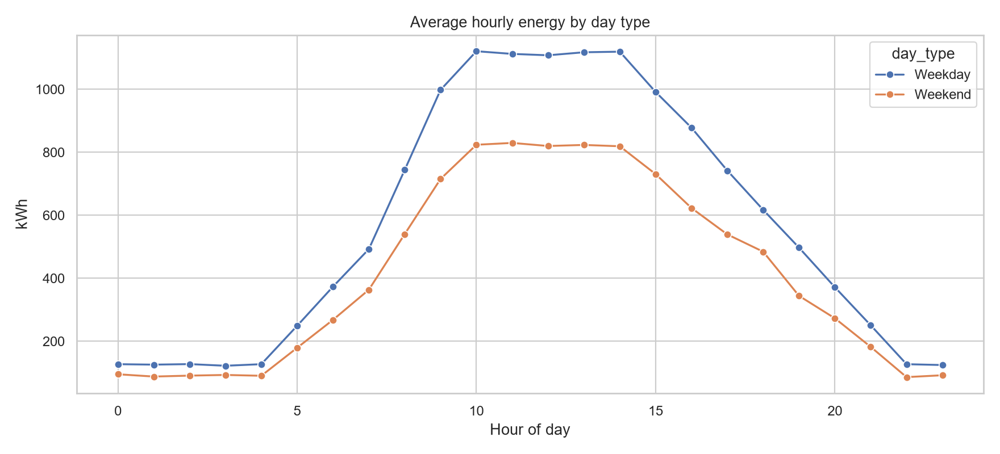
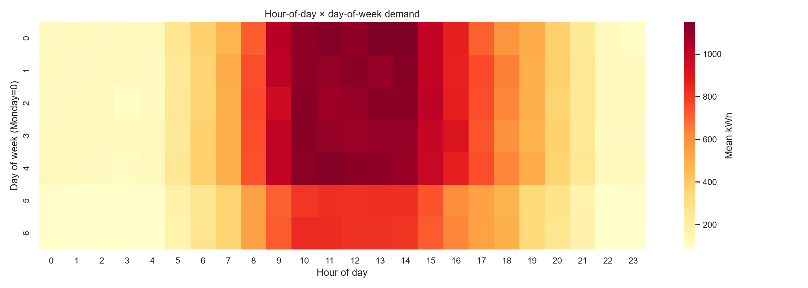
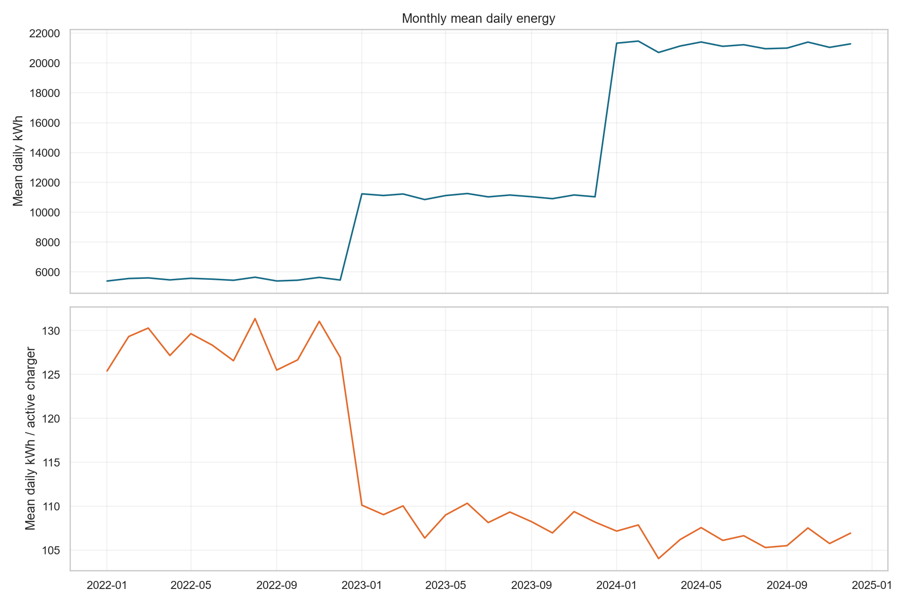
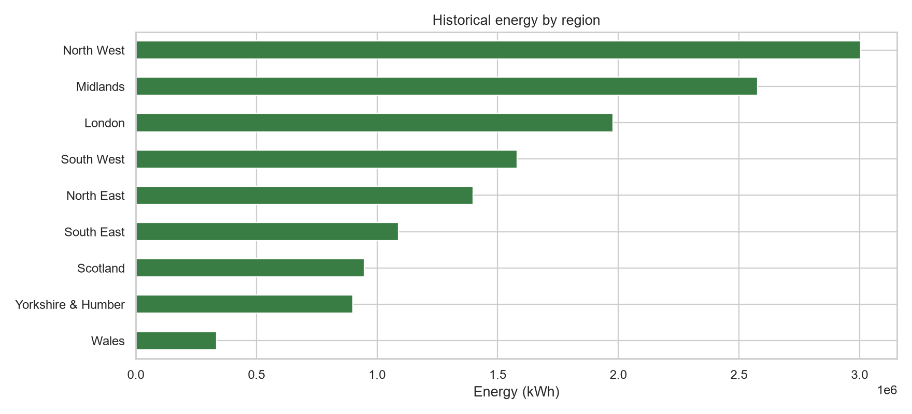
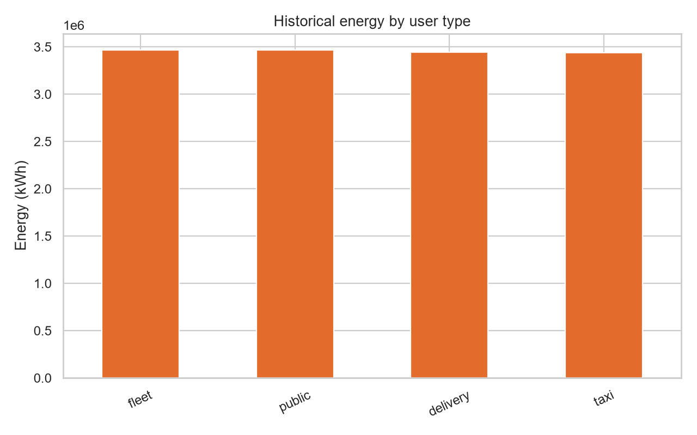
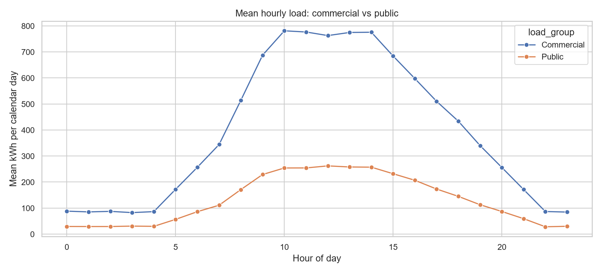

# Task 1: EV Charging Demand — EDA and Insights

## Data and method

The findings below are calculated from the supplied 2022–2024 session records and the processed continuous hourly/daily files. Network rollout is material: comparisons include both total demand and average demand per active charger where relevant. Station active counts use `activation_year` as a January 1 step change. 88,466 sessions have a start timestamp earlier than their charger's recorded installation date, so charger capacity is also represented as a January 1 step change using cumulative annual installation totals (43, 102, and 199 chargers). This avoids using contradictory within-year installation dates as an exact exposure timeline. These are descriptive findings, not causal estimates.

## Weekday and weekend demand

| Day type | Mean daily energy (kWh) | Mean daily kWh per active charger |
|---|---:|---:|
| Weekday | 13,650.8 | 123.8 |
| Weekend | 9,980.4 | 91.2 |

Weekend total mean demand is -26.9% relative to weekdays; the per-active-charger comparison is -26.3%. Use the per-charger comparison when setting routine staffing and capacity baselines, and the total-demand comparison for network-wide procurement.

## Hour-of-day profile

Hours 10:00–14:00 account for 40.9% of energy across the observed period. Mean daily energy summed across those five hours is 5,156.1 kWh, compared with 806.1 kWh during 00:00–05:00. Prioritize staffing and charger availability around the measured peak window; use the overnight profile to identify practical windows for maintenance and any flexible procurement or charging incentives.

## Monthly and quarterly seasonality

Mean daily demand is highest in Feb (12,818.5 kWh/day) and lowest in Sep (12,477.4 kWh/day). After normalizing for active chargers, the highest monthly mean is May (115.4 kWh/charger/day) and the lowest is Sep (113.1 kWh/charger/day). By quarter, total demand peaks in Q1 (12,654.6 kWh/day) and is lowest in Q3 (12,542.7 kWh/day); normalized demand peaks in Q1 (114.8 kWh/charger/day) and is lowest in Q3 (114.1 kWh/charger/day). Review both series before attributing changes to seasonality.

## Regional concentration

The largest regional share is North West at 21.8% of region-tagged energy; the three largest regions together account for 54.7%. Allocate capacity review and local procurement attention in proportion to regional load, while validating utilization and station outages before adding hardware.

## User type and commercial load

| User type | Historical energy (kWh) | Share | Mean weekday kWh/day | Mean weekend kWh/day | Energy share 10:00–14:00 | Mean-load peak hour |
|---|---:|---:|---:|---:|---:|---|
| fleet | 3,466,675 | 25.1% | 3,421.6 | 2,519.1 | 40.9% | 10:00 |
| public | 3,463,845 | 25.1% | 3,430.0 | 2,489.2 | 40.7% | 12:00 |
| delivery | 3,442,219 | 24.9% | 3,396.0 | 2,504.8 | 41.2% | 10:00 |
| taxi | 3,436,007 | 24.9% | 3,403.2 | 2,467.3 | 40.9% | 11:00 |

Commercial user categories (fleet, delivery, taxi) account for 74.9% of categorized energy; public charging accounts for 25.1%. The mean-load peak hours are 10:00 for combined commercial charging and 12:00 for public charging. Use the weekday/weekend and hourly figures to align commercial account scheduling and staffing with when that load arrives. Public-facing staffing and communications should be planned around the separate weekend and daytime profile rather than assuming a single network-wide schedule.

## Operational recommendations

1. **Capacity planning:** baseline near-term capacity from active-charger-normalized demand and the explicit rollout regressor; investigate high-utilization stations before broad expansion.
2. **Staffing:** use the measured hourly and day-type profiles to stagger coverage toward the 10:00–14:00 peak, then tune the schedule by region and user mix.
3. **Energy procurement:** combine the seasonal monthly profile with forecast scenarios and a reserve informed by the 80%/95% intervals; treat the 199-charger forecast as a fixed-capacity scenario, not an expansion plan.
4. **Commercial operations:** coordinate fleet, delivery, and taxi charging windows where the observed load profile permits, protecting public access at shared stations.

These recommendations should be revisited as new operational data arrives; the descriptive pattern can reflect both demand shifts and the network's staged rollout.
